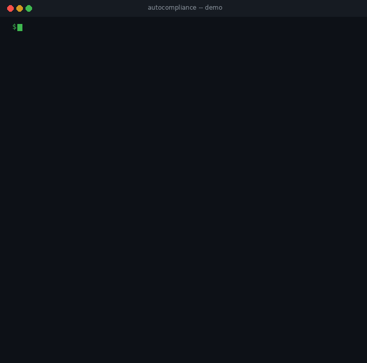
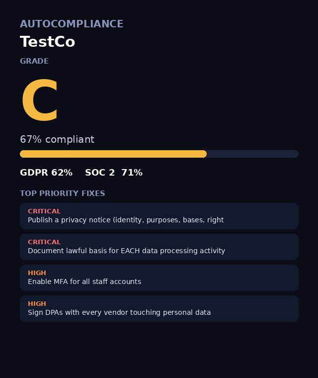

# 🛡️ AutoCompliance

[](https://www.python.org/downloads/)
[](LICENSE)
[]()
[]()

**GDPR + SOC 2 compliance autopilot for small businesses.**

Compliance consultants charge $5,000–$50,000. AutoCompliance does the first 80% free, in 10 minutes.

## Demo



*Watch it work: answer questions, get your grade, fix list, and documents.*



*Sample report: a company scores 67% (Grade C) with prioritized fixes.*

## Install

**From PyPI** (once published):

```bash
pip install autocompliance
```

**Local development:**

```bash
git clone https://github.com/Mahiroyal804/autocompliance.git
cd autocompliance
pip install -e .
```

Requires Python 3.9+. Zero third-party dependencies — standard library only.

## Usage

```bash
# Full interactive assessment (40 questions, GDPR + SOC 2)
autocompliance assess --company "Acme Inc" --email privacy@acme.com

# Save to a custom folder, with PDFs
autocompliance assess --company "Acme Inc" --output ./compliance-report --pdf

# GDPR only
autocompliance assess --company "Acme Inc" --frameworks GDPR

# Just generate the document templates (no questions)
autocompliance docs --company "Acme Inc" --pdf

# List all controls
autocompliance controls
```

## What you get after 40 questions

Answer 40 yes/no questions and AutoCompliance generates everything into
`./compliance-report/`:

- 📊 **Compliance grade (A–F)** with per-framework scores (GDPR + SOC 2)
- 🎯 **Prioritized fix list** — critical → high → medium, each with a concrete remedy
- 📄 **15 document templates** (markdown + optional PDF):
  - Privacy Policy, DPA template, RoPA sheet
  - SOC 2 readiness checklist, risk register
  - Incident response plan, security policy, DSR playbook
  - Vendor register, retention schedule, access/change policies
  - Backup runbook, LIA & DPIA templates
- 🖼️ **Client-ready HTML report** — show customers and auditors where you stand
- 💾 **Raw JSON** of every answer and score (for your records)

## Example

```
$ autocompliance assess --company "Demo Inc" --output ./compliance-report --pdf

  AutoCompliance assessment — Demo Inc

  GRADE: C  (59%)
  GDPR: 61%

  Top fixes:
  [HIGH] Publish a privacy notice
  [HIGH] Define one intake channel
  [HIGH] Enable TLS everywhere

  Report: ./compliance-report/compliance-report.html
  30 documents: ./compliance-report/documents
```

## What's inside

| Framework | Controls | Questions |
|---|---|---|
| GDPR | 9 (lawful basis, transparency, DSR, security, breach, RoPA, vendors, minimization, DPIA/DPO) | 22 |
| SOC 2 | 7 (access, change, monitoring, backups, vendors, risk, policies) | 18 |
| **Total** | **16** | **40** |

Questions live in `autocompliance/questions.json` (plain JSON — no YAML parser needed,
keeping the package dependency-free).

## Development

```bash
# Run tests (stdlib unittest, no pytest needed)
python -m unittest discover -s tests

# Build for PyPI
python -m build

# Check the package
twine check dist/*
```

## Roadmap

- [ ] Web UI + hosted SaaS version
- [ ] Evidence collection (auto-check TLS, DNS, headers)
- [ ] ISO 27001 module
- [ ] Auditor export pack

## Disclaimer

Templates are starting points, not legal advice. Have a lawyer review before relying on them.

## License

MIT — make compliance boring. 🛡️
